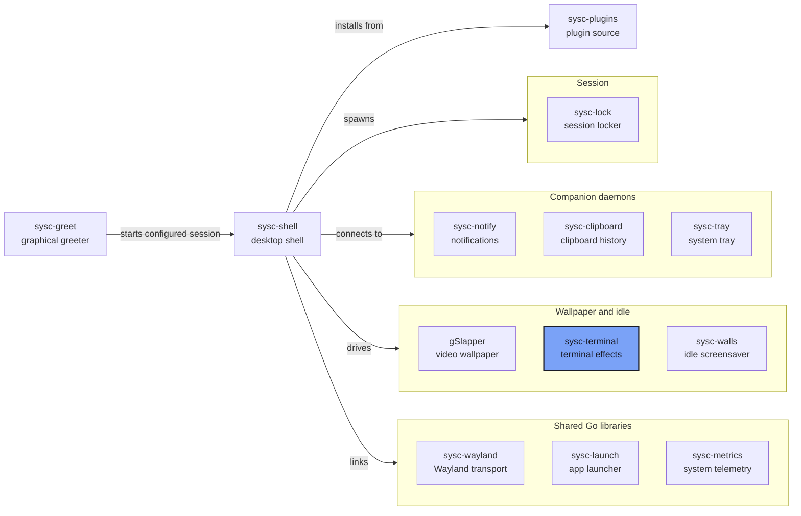

<p align="center">
  
</p>


Live sysc-Go terminal effects as a Wayland wallpaper. Runs on Niri's background layer,
with one process per output.

<p align="center">
  
</p>

<p align="center"><sub>1920×1080 at 20 fps, with the theme selectors and ThinkPad panel open between effects.</sub></p>

## Quick Links

- [Documentation site](https://nomadcxx.github.io/sysc/docs/components/sysc-terminal/)
- [Documentation](#documentation)
- [The sysc ecosystem](https://github.com/Nomadcxx/sysc-shell/blob/main/docs/ecosystem.md)

## Installation

Runtime rendering needs a monospace font with braille coverage. The default search checks
JetBrains Mono (Nerd Font first), then DejaVu Sans Mono and Noto Sans Mono, under
`/usr/share/fonts/`, `/usr/local/share/fonts/` and the Nix store profile — matching both the
Arch/Nix `TTF/` layout and the Debian/Ubuntu `truetype/` layout — then falls back to any font
file found under those roots. Use `--font /path/to/font.ttf` for another location.

### Go installation

```bash
GOBIN="$HOME/.local/bin" CGO_ENABLED=0 go install github.com/Nomadcxx/sysc-terminal/cmd/sysc-terminal@main
export PATH="$HOME/.local/bin:$PATH"
sysc-terminal --list
```

Keep `~/.local/bin` on the PATH of the shell service, then restart sysc-shell so it probes the
catalog. In sysc-shell, open Terminal Art from the Control Centre or Settings, choose an effect and
palette, and apply it to an output.

### AK-47 variants

`ak-47` rotates twice and swirls. For custom artwork, use
`--effect ak-47-text --file /path/to/art.txt`; it follows the same 14-second
loop. The file must contain literal UTF-8 artwork within 64 KiB.

### Custom artwork

Text effects (`--list` marks them with `1`) read artwork from `--file`. The
path must be absolute and resolve under `~/.config`, `~/.local/share`,
`/usr/share` or `/usr/local/share`.
[sysclet](https://github.com/Nomadcxx/sysclet) renders text with TheDraw
fonts into such a file:

```bash
sysclet export --font-name Bleach --format sysc-terminal --output niri NIRI
```

It writes `~/.local/share/syscgo/walls/niri.txt` and prints the full
`sysc-terminal --effect beam-text --file` command for it.

### Australian L2A1 SAR

`l2a1-sar` rotates the braille model twice, then swirls and reconstructs it.
The animation displays `L2A1 SAR / notcplkerry / CC BY 4.0`.

### Rotating statue effects

`jesus-christ-statue`, `jason`, `nymphe-der-flora`, `lowe`, `roman-gladiator`,
and `grabfigur` rotate upright around their vertical axis with a fixed camera
elevation. Each braille frame displays the model title, creator, and license.
`sysc-terminal --list` reports all six IDs for the sysc-shell Terminal Art panel.

### AUR

On Arch, install [sysc-terminal](https://aur.archlinux.org/packages/sysc-terminal) with
your AUR helper:

```sh
yay -S sysc-terminal
```

The package includes the default monospace font. Restart sysc-shell, then choose
an effect from Terminal Art in Settings.

[Documentation](https://nomadcxx.github.io/sysc/docs/).

## Usage

```bash
sysc-terminal --output eDP-1 --effect fire --theme nord --ipc-socket "$XDG_RUNTIME_DIR/sysc-terminal.sock"

# Fighter aircraft rotate horizontally
sysc-terminal --output eDP-1 --effect f-14-tomcat --theme kanagawa --ipc-socket "$XDG_RUNTIME_DIR/sysc-terminal.sock"
```

Add `--blur 16` to soften the wallpaper; the range is 0..64 output pixels, with 0 off.
In sysc-shell, Settings → Terminal Art stores the blur strength for your next effect selection.

Add `--fps 10` to cap the animation rate; the range is 1..20, defaulting to 20. The same cap can be
changed on a running process with the `fps` verb, which the shell uses to save power while the
wallpaper is covered, locked, on battery or off-screen.

Get the connector from `niri msg outputs`. Run one process per output with a distinct socket.

Socket verbs: `query`, `fps [n]`, `pause`, `resume`, `change effect <id> theme <theme> [file <path>]`,
`reset`, `stop`. A paused process keeps its last frame.

## Rendering

- `wlr-layer-shell` Background surface, namespace `sysc-terminal`
- Bounded ANSI cell grid with a subset of SGR colour, wide-rune handling, and caps on frame bytes
  and cells
- Font rasterisation with a glyph cache, into double-buffered `wl_shm` ARGB8888 buffers
- 20 FPS ceiling with blur off, 8.3 FPS with blur enabled, and `--fps` lowers either without raising
  the budget; the warmed `fire`/`nord` frame check at 3440×1440 targets less than 25% of one
  CPU core (mean and p95). CPU use varies with effect, font, output and hardware.
- One process per output, each with its own socket
- `--list` reports the effect IDs, themes and text effects from the live sysc-Go registry
- Text effects accept `--file`

### Custom text art

[sysclet v0.3.0 or later](https://github.com/Nomadcxx/sysclet/releases) exports plain-text headers for text effects:

```sh
sysclet export --format sysc-terminal --font-name Bleach \
  --output "$HOME/.local/share/sysc-terminal/header" SYSC
sysc-terminal --output eDP-1 --effect beam-text --theme nord \
  --file "$HOME/.local/share/sysc-terminal/header.txt"
```

sysclet adds the `.txt` extension. Its output path must be under `~/.local/share` or `~/.config`.

## Build

Pins Go 1.26, sysc-Go `v1.0.9-0.20261022010724-1fa198051d89` and sysc-wayland `v0.3.1`. Niri
first, no CGO.

```bash
go generate ./internal/wayland/...
timeout 90s env CGO_ENABLED=0 GOMAXPROCS=2 go build -o /tmp/sysc-terminal ./cmd/sysc-terminal
```

Tests are named and run individually; the full tree and `-race` are not run on the development
laptop.

## Ecosystem



[The sysc ecosystem](https://github.com/Nomadcxx/sysc-shell/blob/main/docs/ecosystem.md) explains
each connection, socket and version pin.

## Documentation

- [The sysc ecosystem](https://github.com/Nomadcxx/sysc-shell/blob/main/docs/ecosystem.md)
- [docs/plans](docs/plans) — design and feasibility notes

## Effect gallery

<details>
<summary>More themes and effect screenshots</summary>

The shell takes the effect's theme, so the bar, window borders and terminals follow it.

- [sysc-logo in Rama](https://github.com/user-attachments/assets/f6de15a4-4a31-4af3-83de-4644d6009512)
- [logo-morph in Dracula](https://github.com/user-attachments/assets/74784eba-cb6f-4b17-94ce-fc7cb8732c7a)

Each effect below runs as the wallpaper under sysc-shell, in a different theme.

<table>
  <tr>
    <td align="center" valign="top"><br><sub>Fire, Eldritch</sub></td>
    <td align="center" valign="top"><br><sub>Matrix, Nord</sub></td>
  </tr>
  <tr>
    <td align="center" valign="top"><br><sub>Rain, Tokyo Night</sub></td>
    <td align="center" valign="top"><br><sub>Beams, Dracula</sub></td>
  </tr>
  <tr>
    <td align="center" valign="top"><br><sub>Aquarium, Catppuccin</sub></td>
    <td align="center" valign="top"><br><sub>Fireworks, Gruvbox</sub></td>
  </tr>
</table>

</details>

## License

MIT. Effects come from [sysc-Go](https://github.com/Nomadcxx/sysc-Go) (MIT); transport from
[sysc-wayland](https://github.com/Nomadcxx/sysc-wayland) (BSD-3-Clause).

The AK-47 effect includes model data from ["AK-47" by Lokeig](https://skfb.ly/oyAsI),
licensed under [CC BY-NC 4.0](https://creativecommons.org/licenses/by-nc/4.0/).
That asset retains its noncommercial restriction. The adaptation samples the
mesh into braille surface points and adds rotation and a particle morph.

The Australian L2A1 SAR effect includes model data from ["low-poly Australian L2A1 SAR" by notcplkerry](https://skfb.ly/oErMB),
licensed under [CC BY 4.0](https://creativecommons.org/licenses/by/4.0/).
The animation displays `L2A1 SAR / notcplkerry / CC BY 4.0`.

The rotating model effects include model-derived samples from these works:

| Model | Creator | Source | License |
|---|---|---|---|
| Jesus Christ Statue | amcgi | [Sketchfab](https://sketchfab.com/3d-models/jesus-christ-statue-375d626ccd524c439e9dc81c1033828e) | [CC BY 4.0](https://creativecommons.org/licenses/by/4.0/) |
| Jason | noe-3d.at | [Sketchfab](https://sketchfab.com/3d-models/jason-e7da6b09d300488e93fbe384412b8b18) | [CC BY-NC 4.0](https://creativecommons.org/licenses/by-nc/4.0/) |
| Nymphe der Flora | noe-3d.at | [Sketchfab](https://sketchfab.com/3d-models/nymphe-der-flora-f1f4fca883954c0e9ac2bda9e865b144) | [CC BY-NC 4.0](https://creativecommons.org/licenses/by-nc/4.0/) |
| Löwe | noe-3d.at | [Sketchfab](https://sketchfab.com/3d-models/lowe-7e78d1f7fe04481697f1388ebba6ef9f) | [CC BY-NC 4.0](https://creativecommons.org/licenses/by-nc/4.0/) |
| Sculpture of a Roman gladiator | Virtual Museums of Małopolska | [Sketchfab](https://sketchfab.com/3d-models/sculpture-of-a-roman-gladiator-ca42e593d8aa4b2894dc2b288f595af5) | [CC BY 4.0](https://creativecommons.org/licenses/by/4.0/) |
| Grabfigur | noe-3d.at | [Sketchfab](https://sketchfab.com/3d-models/grabfigur-0c69e48471de4467aba03c5767164237) | [CC BY-NC 4.0](https://creativecommons.org/licenses/by-nc/4.0/) |
| Laocoon and His Sons | Rigsters | [Sketchfab](https://sketchfab.com/3d-models/laocoon-and-his-sons-649111a9a7b74ddab3937292be5545fc) | [CC BY 4.0](https://creativecommons.org/licenses/by/4.0/) |
| The bust of Napoleon Bonaparte | Virtual Museums of Małopolska | [Sketchfab](https://sketchfab.com/3d-models/the-bust-of-napoleon-bonaparte-a177bf0e121641bea6cf1d58ad3efc5b) | [CC BY 4.0](https://creativecommons.org/licenses/by/4.0/) |
| Brandenburg Gate (9 Mb) | Resinnnn | [Sketchfab](https://sketchfab.com/3d-models/brandenburg-gate-9-mb-012f2cb87cfa47029808063da072ad5c) | [CC BY 4.0](https://creativecommons.org/licenses/by/4.0/) |
| Louis XIV de France, Louvre, Paris | HoangHiepVu | [Sketchfab](https://sketchfab.com/3d-models/louis-xiv-de-france-louvre-paris-a0cc0e7eee384c99838dff2857b8158c) | [CC BY 4.0](https://creativecommons.org/licenses/by/4.0/) |
| Engel | noe-3d.at | [Sketchfab](https://sketchfab.com/3d-models/engel-a625483175624e0ab6f7cd67ee53cc92) | [CC BY-NC 4.0](https://creativecommons.org/licenses/by-nc/4.0/) |
| Hl. Georg als Drachentöter | VIMUNE | [Sketchfab](https://sketchfab.com/3d-models/hl-georg-als-drachentoter-a211b6af71b249e1a03854d00fc41cbd) | [CC BY-SA 4.0](https://creativecommons.org/licenses/by-sa/4.0/) |
| Santa Muerte & Requiem for the Sketchfab | Mateusz Woliński | [Sketchfab](https://sketchfab.com/3d-models/santa-muerte-requiem-for-the-sketchfab-3fa36f79496a454995c64ca65b5d52b0) | [CC BY-SA 4.0](https://creativecommons.org/licenses/by-sa/4.0/) |
| Aspasia | noe-3d.at | [Sketchfab](https://sketchfab.com/3d-models/aspasia-6f0bd1e65a244cc78c5fe082c8e0d3d1) | [CC BY-NC 4.0](https://creativecommons.org/licenses/by-nc/4.0/) |
| Hl. Nepomuk | noe-3d.at | [Sketchfab](https://sketchfab.com/3d-models/hl-nepomuk-9d65daaa9e07470cad5ce7c668b03434) | [CC BY-NC 4.0](https://creativecommons.org/licenses/by-nc/4.0/) |
| Lion Statue - optimized | Thomas Flynn | [Sketchfab](https://sketchfab.com/3d-models/lion-statue-optimized-62662d27c94d4994b2479b8de3a66ca7) | [CC0 1.0](https://creativecommons.org/publicdomain/zero/1.0/) |
| F-14 Tomcat - Fighter Jet - Free | bohmerang | [Sketchfab](https://sketchfab.com/3d-models/f-14-tomcat-fighter-jet-free-497f77c311b5411d9b567d8707a81c33) | [CC BY-NC-SA 4.0](https://creativecommons.org/licenses/by-nc-sa/4.0/) |
| F-15E Strike Eagle - Fighter Jet - Free | bohmerang | [Sketchfab](https://sketchfab.com/3d-models/f-15e-strike-eagle-fighter-jet-free-fff7d75490474e9b964d90cc031c8d01) | [CC BY-NC-SA 4.0](https://creativecommons.org/licenses/by-nc-sa/4.0/) |
| F-22 Raptor - Fighter Jet - Free | bohmerang | [Sketchfab](https://sketchfab.com/3d-models/f-22-raptor-fighter-jet-free-508de5c48845456bb033fb267ebe1d1e) | [CC BY-NC-SA 4.0](https://creativecommons.org/licenses/by-nc-sa/4.0/) |
| F/A-18E Super Hornet (USA) | 42manako | [Sketchfab](https://sketchfab.com/3d-models/fa-18e-super-hornet-usa-0eb69d3fd53945488245b7d8464ffaa5) | [CC BY-NC 4.0](https://creativecommons.org/licenses/by-nc/4.0/) |

CC BY-NC models retain their noncommercial restriction. CC BY-SA and CC
BY-NC-SA models retain their share-alike terms. The three bohmerang aircraft
bakes also retain the CC BY-NC-SA noncommercial restriction. Each effect
displays attribution in its braille frame.

---

<a href="https://github.com/Nomadcxx"></a> — terminal-native tooling for the linux desktop.
[More projects →](https://github.com/Nomadcxx) · [Sponsor](https://github.com/sponsors/Nomadcxx) ❤️
