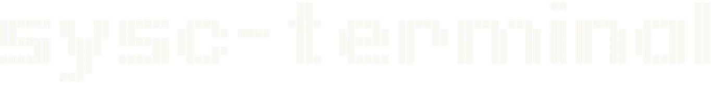
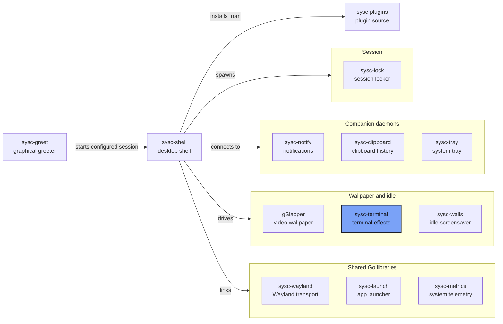
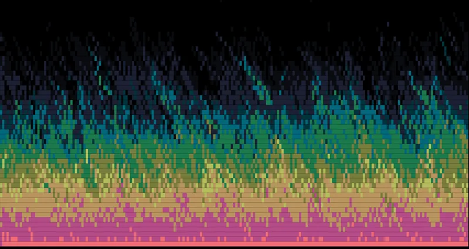
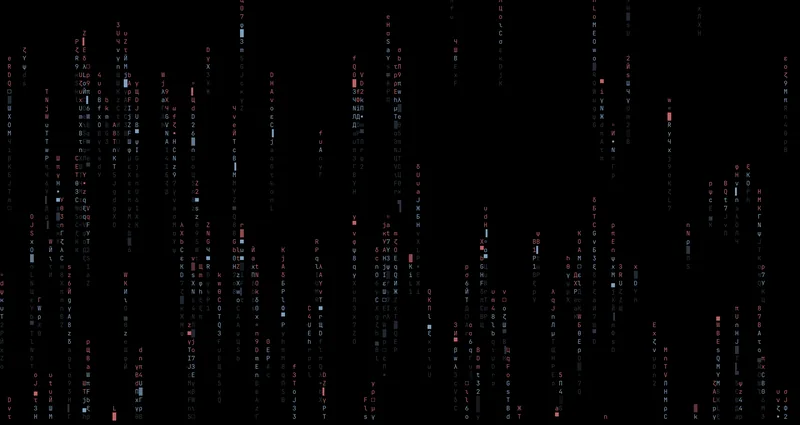
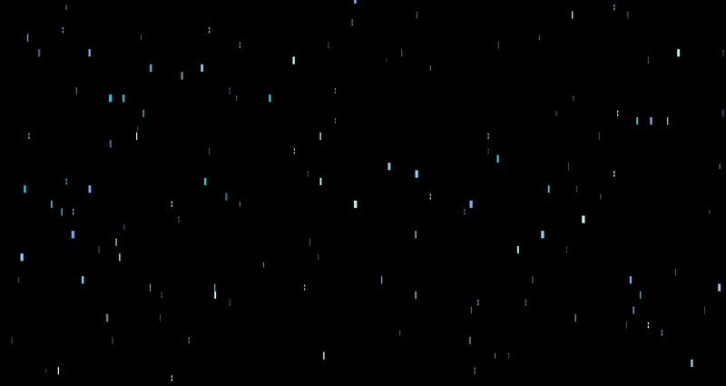
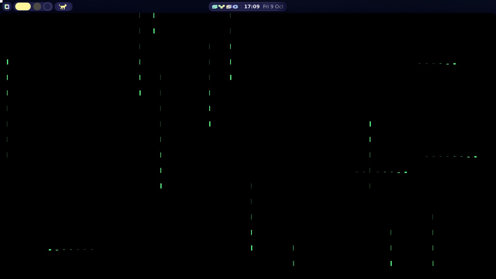
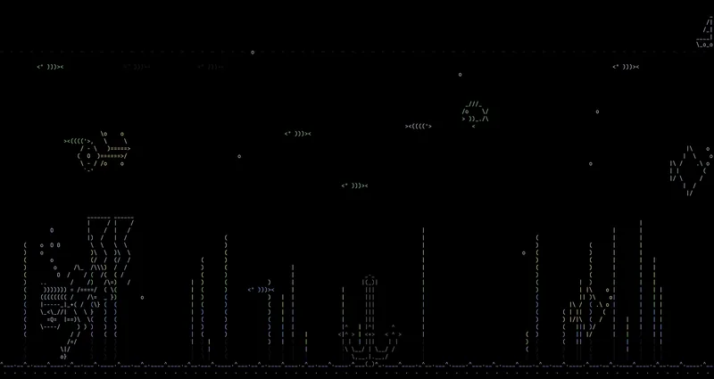
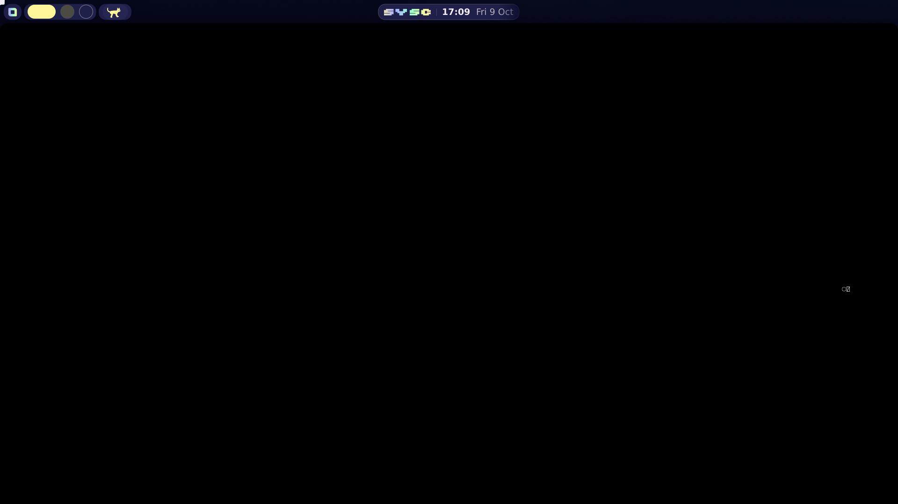

<p align="center">
  
</p>


Live sysc-Go terminal effects as a Wayland wallpaper. Runs on Niri's background layer,
with one process per output.

<p align="center">
  
</p>

<p align="center"><sub>1920×1080 at 20 fps, with the theme selectors and ThinkPad panel open between effects.</sub></p>

## Quick Links

- [Documentation site](https://nomadcxx.github.io/sysc/docs/components/sysc-terminal/)
- [Documentation](#documentation)
- [The sysc ecosystem](https://github.com/Nomadcxx/sysc-shell/blob/main/docs/ecosystem.md)

## Installation

Runtime rendering needs a monospace font with braille coverage. The default search checks
JetBrains Mono (Nerd Font first), then DejaVu Sans Mono and Noto Sans Mono, under
`/usr/share/fonts/`, `/usr/local/share/fonts/` and the Nix store profile — matching both the
Arch/Nix `TTF/` layout and the Debian/Ubuntu `truetype/` layout — then falls back to any font
file found under those roots. Use `--font /path/to/font.ttf` for another location.

### Go installation

```bash
GOBIN="$HOME/.local/bin" CGO_ENABLED=0 go install github.com/Nomadcxx/sysc-terminal/cmd/sysc-terminal@main
export PATH="$HOME/.local/bin:$PATH"
sysc-terminal --list
```

Keep `~/.local/bin` on the PATH of the shell service, then restart sysc-shell so it probes the
catalog. In sysc-shell, open Terminal Art from the Control Centre or Settings, choose an effect and
palette, and apply it to an output.

### AK-47 variants

`ak-47` rotates twice and swirls. For custom artwork, use
`--effect ak-47-text --file /path/to/art.txt`; it follows the same 14-second
loop. The file must contain literal UTF-8 artwork within 64 KiB.

### AUR

On Arch, install [sysc-terminal](https://aur.archlinux.org/packages/sysc-terminal) with
your AUR helper:

```sh
yay -S sysc-terminal
```

The package includes the default monospace font. Restart sysc-shell, then choose
an effect from Terminal Art in Settings.

[Documentation](https://nomadcxx.github.io/sysc/docs/).

## Usage

```bash
sysc-terminal --output eDP-1 --effect fire --theme nord --ipc-socket "$XDG_RUNTIME_DIR/sysc-terminal.sock"
```

Add `--blur 16` to soften the wallpaper; the range is 0..64 output pixels, with 0 off.
In sysc-shell, Settings → Terminal Art stores the blur strength for your next effect selection.

Add `--fps 10` to cap the animation rate; the range is 1..20, defaulting to 20. The same cap can be
changed on a running process with the `fps` verb, which the shell uses to save power while the
wallpaper is covered, locked, on battery or off-screen.

Get the connector from `niri msg outputs`. Run one process per output with a distinct socket.

Socket verbs: `query`, `fps [n]`, `pause`, `resume`, `change effect <id> theme <theme> [file <path>]`,
`reset`, `stop`. A paused process keeps its last frame.

## Rendering

- `wlr-layer-shell` Background surface, namespace `sysc-terminal`
- Bounded ANSI cell grid with a subset of SGR colour, wide-rune handling, and caps on frame bytes
  and cells
- Font rasterisation with a glyph cache, into double-buffered `wl_shm` ARGB8888 buffers
- 20 FPS ceiling with blur off, 8.3 FPS with blur enabled, and `--fps` lowers either without raising
  the budget; the warmed `fire`/`nord` frame check at 3440×1440 targets less than 25% of one
  CPU core (mean and p95). CPU use varies with effect, font, output and hardware.
- One process per output, each with its own socket
- `--list` reports the effect IDs, themes and text effects from the live sysc-Go registry
- Text effects accept `--file`

## Build

Pins Go 1.26, sysc-Go `v1.0.6-0.20261008172414-1ff1f6c3c8d0` and sysc-wayland `v0.3.1`. Niri
first, no CGO.

```bash
go generate ./internal/wayland/...
timeout 90s env CGO_ENABLED=0 GOMAXPROCS=2 go build -o /tmp/sysc-terminal ./cmd/sysc-terminal
```

Tests are named and run individually; the full tree and `-race` are not run on the development
laptop.

## Ecosystem



[The sysc ecosystem](https://github.com/Nomadcxx/sysc-shell/blob/main/docs/ecosystem.md) explains
each connection, socket and version pin.

## Documentation

- [The sysc ecosystem](https://github.com/Nomadcxx/sysc-shell/blob/main/docs/ecosystem.md)
- [docs/plans](docs/plans) — design and feasibility notes

## Effect gallery

<details>
<summary>More themes and effect screenshots</summary>

The shell takes the effect's theme, so the bar, window borders and terminals follow it.

- [sysc-logo in Rama](https://github.com/user-attachments/assets/f6de15a4-4a31-4af3-83de-4644d6009512)
- [logo-morph in Dracula](https://github.com/user-attachments/assets/74784eba-cb6f-4b17-94ce-fc7cb8732c7a)

Each effect below runs as the wallpaper under sysc-shell, in a different theme.

<table>
  <tr>
    <td align="center" valign="top"><br><sub>Fire, Eldritch</sub></td>
    <td align="center" valign="top"><br><sub>Matrix, Nord</sub></td>
  </tr>
  <tr>
    <td align="center" valign="top"><br><sub>Rain, Tokyo Night</sub></td>
    <td align="center" valign="top"><br><sub>Beams, Dracula</sub></td>
  </tr>
  <tr>
    <td align="center" valign="top"><br><sub>Aquarium, Catppuccin</sub></td>
    <td align="center" valign="top"><br><sub>Fireworks, Gruvbox</sub></td>
  </tr>
</table>

</details>

## License

MIT. Effects come from [sysc-Go](https://github.com/Nomadcxx/sysc-Go) (MIT); transport from
[sysc-wayland](https://github.com/Nomadcxx/sysc-wayland) (BSD-3-Clause).

The AK-47 effect includes model data from ["AK-47" by Lokeig](https://skfb.ly/oyAsI),
licensed under [CC BY-NC 4.0](https://creativecommons.org/licenses/by-nc/4.0/).
That asset retains its noncommercial restriction. The adaptation samples the
mesh into braille surface points and adds rotation and a particle morph.

---

<a href="https://github.com/Nomadcxx"></a> — terminal-native tooling for the linux desktop.
[More projects →](https://github.com/Nomadcxx) · [Sponsor](https://github.com/sponsors/Nomadcxx) ❤️
